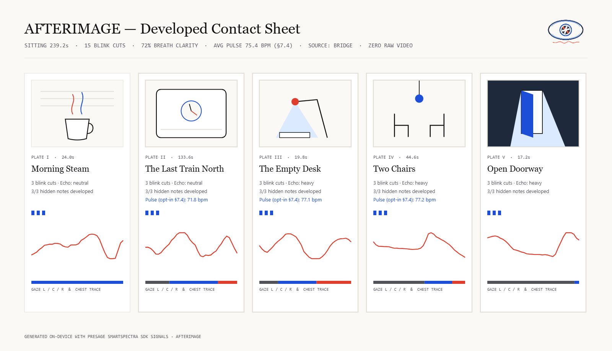
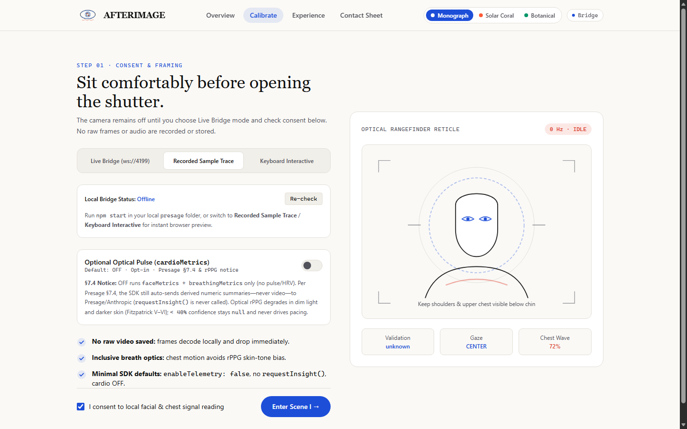
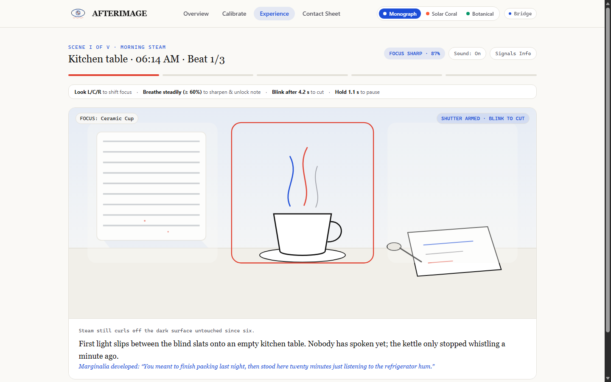
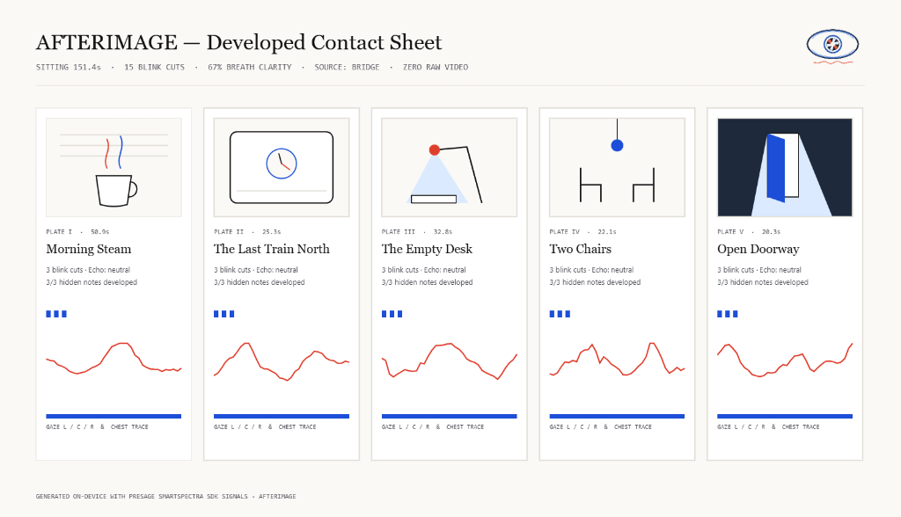
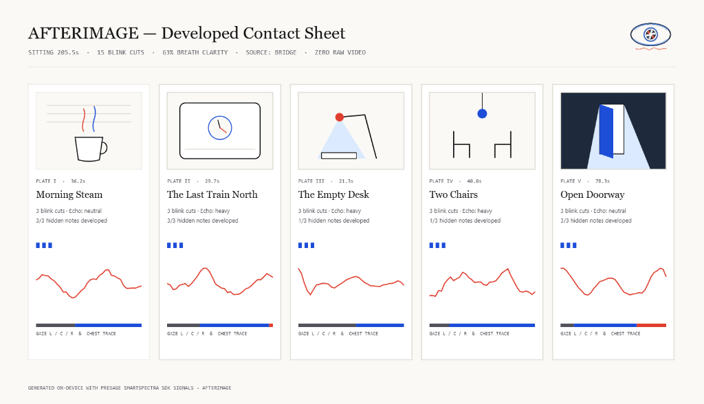
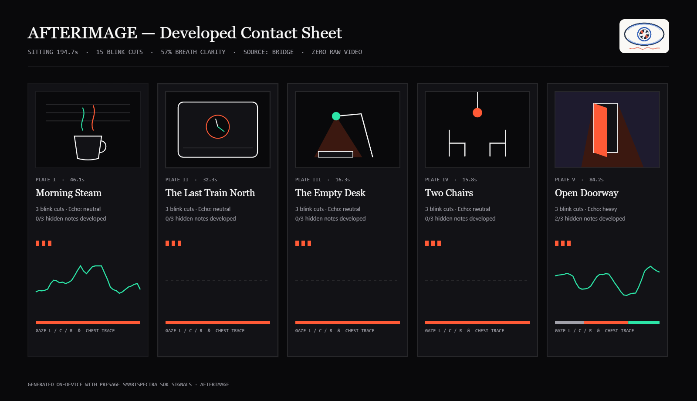

<p align="center">
  
</p>

# AFTERIMAGE

> *A blink is a cut, not a click. Breathe steady to hold the frame still.*

**AFTERIMAGE** is a five-scene interactive visual essay navigated without touching a keyboard, powered by the **Presage SmartSpectra Node.js SDK (`@smartspectra/node-sdk@3.5.0`)**. Inspired by film editor [**Walter Murch**'s](https://www.imdb.com/name/nm0004555/) [*In the Blink of an Eye*](https://en.wikipedia.org/wiki/In_the_Blink_of_an_Eye_%28book%29) (the observation that a human blink punctuates one thought from the next alongside the rhythm of breathing) and the blink-driven memory storytelling of [*Before Your Eyes*](https://www.imdb.com/title/tt15575678/), AFTERIMAGE turns involuntary webcam signals into slow darkroom controls: where you look shifts focus across a three-panel plate, chest breathing steadiness clears optical haze and develops hidden marginalia, and every natural blink turns the page once a **`4.2 s` Shutter Armed** dwell lock clears—ending in an exportable **Contact Sheet (`.png`)** of your sitting.

Built as a solo submission for the [Presage SmartSpectra SDK Challenge](https://dev.to/challenges/presage-2026-11-04).

- **Interactive Preview (Vercel):** https://afterimage-presage.vercel.app *(boots automatically into **Recorded Sample Trace** mode replaying `670` keyframes across `352.4 s` from a real narrated Windows SmartSpectra sitting at 1× pace, or **Keyboard Interactive** mode)*
- **Source Code:** https://github.com/emarc99/presage-dev
- **Windows Hardware & SDK Log:** [`docs/SDK-NOTES.md`](./docs/SDK-NOTES.md)

<p align="center">
  
</p>
<p align="center"><em>Sitting 3 Contact Sheet PNG exported from the live narrated Windows webcam bridge: 239.2 s, 15 blink cuts, 72% breath clarity, AVG PULSE 75.4 BPM (opt-in §7.4: 71.8 / 77.1 / 77.2 bpm on Plates II–IV, honestly suppressed &lt; 40% on Plate I pre-toggle and Plate V extreme left gaze), 807/807 live talking-guard freeze checks across 15 speaking episodes, and 15/15 hidden notes developed.</em></p>

---

## Visual Walkthrough

| `/calibrate` (`Recorded Sample Trace` capture) | `/experience` (`Recorded Sample Trace` capture) |
| :---: | :---: |
|  |  |
| *Explicit pre-capture consent, concise §7.4 `cardioMetrics` opt-in disclosure, and 478-point silhouette reticle (`Chest Wave 72%`).* | *Replaying `670`-frame `sample-trace.json`: `FOCUS SHARP · 87%`, `SHUTTER ARMED · BLINK TO CUT`, Center Ceramic Cup sharp, and cobalt marginalia unlocked.* |

---

## How It Responds to Human Signals

| Signal | SmartSpectra Source | How AFTERIMAGE Processes It | Effect in the Room |
| :--- | :--- | :--- | :--- |
| **Quick Blink Cut** | `face.landmarks` (478 pixel pts) + `face.blinking` | Scale-invariant 6-pt EAR (`< 0.21`) triggered **on reopen** (`< 650 ms`, `360 ms` debounce) with `0.25` EAR native-descent guard + `4.2 s` **Shutter Armed** dwell | Aperture click sound + hard cut across 15 beats (`I–V`); early reading blinks (`30` across the full `352.4 s` sitting) ripple silently |
| **Long Eye-Close Pause** | Prolonged low EAR (`< 0.21` held `>= 1.1 s`) | Descent guard (`lastEar >= 0.25`) + `>= 400 ms` suppression stops native `face.blinking` from firing during long closures | Toggles pause / resume cleanly without advancing beat (`4` live pauses verified) |
| **Horizontal Gaze (`L / C / R`)** | Iris centers (`468`, `473`) + nose/cheek `yawRatio` | Additive deviation around center (`0.5 + irisDelta * 0.95 + yawDelta * 0.55`), `< 0.455 / > 0.545` with return hysteresis | Shifts sharp panel (`420 ms` crossfade), parallax depth, zone captions, and stereo WebAudio pan |
| **Chest Breath Steadiness** | `breathing.upperTrace` + `breathing.rate` + `face.talking` | `4.5 s` OLS linear detrend + 2nd-diff curvature steadiness + `>= 5`-frame talking onset (`900 ms` hold) guard (`807/807` checks live) | Clears SVG blur (`feGaussianBlur`), slows drift velocity, swells pink-noise bed; `>= 60%` rings chime & reveals hidden note |
| **Subtle Tonal Echo** | `face.expression` (`HAPPY`, `SAD`, `FEAR`, `ANGRY`, `NEUTRAL`) | `0.82/0.18` warm (`>= 45%`), `0.90/0.10` heavy (`>= 86%`) EMA to tolerate downward laptop camera angles | Subtle color temperature & ambient chord detune (`neutral` / `warm` / `heavy`) |
| **Optical Pulse (Opt-in)** | `cardio.pulseRate` (`cardioMetrics`, **OFF by default**) | Confidence-gated (`>= 40%`, else `null`); never steers scene timing or unlocks | Displayed read-only on `/calibrate` and `/contact-sheet` only when explicitly toggled ON |

---

## Sitting 1 → Sitting 2 → Sitting 3 Calibration Progression

| Run | Duration & Frames | Breath Clarity | Gaze Split (`L / C / R`) | Notes Unlocked | What Broke / What Fixed It |
| :--- | :--- | :--- | :--- | :--- | :--- |
| **Pre-flight probe** | `0 s` (`kInputUnavailable`) | — | — | — | `CameraSelection.front` failed on Windows MediaFoundation; `checkDeviceReadiness()` stalled for 30 s. Switched directly to `CameraSelection.default` / `.byId()` (`~7 s` lock at `29–31 Hz`). |
| **Sitting 1** *(broken pipeline)* | `151.4 s`, `15` blink cuts | Froze at `55%` on startup (`67%` after clearing) | **100% Center** (`0.486–0.493`) | `15/15` | 30 Hz `availableCameras()` + `validationStatus` storm starved React; 1-frame startup `face.talking` froze `55%`; `0.7*iris + 0.3*yaw` pinned gaze at Center. |
| **Sitting 2** *(silent calibrated)* | `205.5 s`, `366` keyframes (`308` `breathRate` msgs) | `63%` 5-plate avg (`63.9%` trace mean, `37–85%`) | `91` Left / `235` Center / `40` Right | `11/15` (`3,3,1,1,3`) | Cached camera list, deduplicated status broadcasts, `>= 5`-frame talking guard, OLS detrending, additive iris+yaw deviation (`0.95 / 0.55`). `26` raw blinks → `11` early ripples + `15` cuts. |
| **Solar Coral rehearsal** *(dark theme)* | `194.7 s`, `15` blink cuts | `57%` 5-plate avg (stalled chest wave on II–IV) | Mixed L / C / R on Plate V | `2/15` (`0,0,0,0,2`) | Chest tracking dropped on Plates II–IV; instead of inventing curves, the sheet printed honest dashed flatlines alongside Solar Coral dark mode. |
| **Sitting 3** *(narrated demo capture, exported above)* | **`239.2 s` essay / `352.4 s` `670` keyframes** (`9,827` 30 Hz msgs at `29.5 fps`, `523` `breathRate` msgs) | **`72%` 5-plate avg** (`72.4%` trace mean, `45–89%`) | **`171` Left / `406` Center / `93` Right** | **`15/15`** + opt-in **`75.4 bpm`** (`71.8 / 77.1 / 77.2`) | Proven live: **`807/807`** talking-guard freeze checks across **`15`** speaking episodes (`57` talking keyframes, `0` violations), **`64`** raw blinks (`30` early ripples + `34` armed across `352.4 s` / `15` essay cuts), opt-in pulse honestly `null` `< 40%` on Plates I & V, and **`4`** long-blink pauses exposing the **`42 ms`** eyelid-descent race (`dt = 289.947 s`, `ear = 0.213`, fixed + Regression Test #21). |

<p align="center">
  
</p>
<p align="center"><em>Sitting 1 (151.4 s) before the additive iris + yaw fix: all five bottom gaze bars are flat cobalt Center.</em></p>

<p align="center">
  
</p>
<p align="center"><em>Sitting 2 (205.5 s, 366 silent keyframes) after the gaze &amp; detrending fixes: multi-zone L/C/R bars (91 Left / 235 Center / 40 Right), honest 1/3 notes on Plates III &amp; IV, and cardioMetrics kept OFF.</em></p>

<p align="center">
  
</p>
<p align="center"><em>Dark-theme <strong>Solar Coral</strong> Contact Sheet from an earlier rehearsal take (194.7 s, 57% breath clarity): dashed gray baselines on Plates II–IV (0/3 notes) reflect honest signal loss when chest wave stalled, compared against active emerald respiratory waves on Plates I and V (2/3). Compare with Sitting 3 at the top.</em></p>

---

## Consent, Privacy & Presage §7.4 Disclosure

- **Camera stays off until explicit consent:** Video capture never opens until you check consent and start capture on `/calibrate` (with warm serialized bridge reuse cleanly across `/calibrate` → `/experience`).
- **No raw frames or audio stored:** Native Node captures at `960×540 @ 30fps` locally (`127.0.0.1:4199`), drops every frame immediately from memory, and streams only normalized `[0..1]` silhouette coordinates and scalar metrics over localhost WebSocket. Microphone permission is never requested.
- **SDK telemetry OFF & `requestInsight()` unused:** `bridge/server.mjs` constructs `SmartSpectraSDK` with `enableTelemetry: false` and never invokes `sdk.requestInsight()`. Both invariants are asserted automatically by tests and CI.
- **Accurate Presage §7.4 LLM Insights disclosure:** `cardioMetrics` stays **OFF by default**, requesting only `faceMetrics + breathingMetrics` so pulse and HRV are never computed or buffered. Per Presage's [LLM Insights docs](https://smartspectra.presagetech.com/docs/llm-insights) and Privacy Policy §7.4, when breathing (`breathing.rate`) or cardio metrics are active, the SDK automatically dispatches buffered derived numeric series (never video) to Presage's Analytics Gateway / Anthropic LLM service and cannot currently be turned off by developers; this behavior is disclosed inline on `/calibrate`. Camera rPPG also degrades in dim lighting and darker skin tones (Fitzpatrick V–VI), so opt-in pulse readings under `40%` confidence are suppressed (`null`).
- **One-click erasure:** Trace recording only runs when manually triggered, and `/contact-sheet` provides one-click in-memory erasure (`Erase Session Data`).

---

## Quickstart & Verification

### 1. Local Live Webcam (`Node.js >= 20`, Windows / macOS / Linux)

```bash
npm install
npm --prefix web install

cp .env.example .env
# Edit .env -> SMARTSPECTRA_API_KEY=...

npm run check   # Runs 21 SignalProcessor unit tests, trace/privacy verifier, and frontend build
npm start       # Starts local SmartSpectra WebSocket bridge + static UI on http://127.0.0.1:4199
```

Useful diagnostics:

```bash
npm run cameras                                            # Enumerate native cameras (no key required)
npm run spike -- --skip-readiness --seconds 20             # Inspect 1 Hz SmartSpectra metrics in terminal
node bridge/server.mjs --record recordings/sitting.jsonl   # Record sanitized signal frames to JSONL
npm run verify-trace                                       # Assert all counts & 4.2s blink gate math on sample-trace.json
```

### 2. Interactive Hosted Preview (Vercel)

Live deployment: **https://afterimage-presage.vercel.app**

Because `@smartspectra/node-sdk` is a native desktop C++/FFI addon, browsers cannot run it directly. When `127.0.0.1:4199` is absent, [vercel.json](./vercel.json) serves the SPA directly into **Recorded Sample Trace** mode (`670` keyframes across `352.4 s` from [`web/public/sample-trace.json`](./web/public/sample-trace.json) at 1× pace) plus **Keyboard Interactive** mode (`Space` = Blink Cut, `←/↑/→` = Gaze, `Shift` / slider = Breath).

---

## Architecture & Empirical Notes

- [`bridge/signal-processor.mjs`](./bridge/signal-processor.mjs) — Scale-invariant EAR blink-on-reopen (`< 650 ms`), `1.1 s` long-blink pause with `0.25` EAR native-descent guard, `>= 5`-frame talking onset & `900 ms` hold guard, additive iris+yaw deviation gaze (`171 / 406 / 93`), `4.5 s` OLS-detrended chest-breath steadiness, calibrated `SAD` echo EMA, confidence-gated (`>= 40%`) opt-in pulse, and `[0..1]` silhouette extraction.
- [`bridge/server.mjs`](./bridge/server.mjs) — Serialized-mutex localhost HTTP + WebSocket bridge with cached camera enumeration, deduplicated `(validation, validationHint)` broadcasts, `enableTelemetry: false`, and JSONL / `sample-trace.json` recording.
- [`scripts/verify-trace.mjs`](./scripts/verify-trace.mjs) — Deterministic verifier checking every published trace count (`670` frames, `171 / 406 / 93`, `72.4%` avg, `57` talking frames, `81` opt-in pulse frames `67.5–85.5 bpm`, `64 → 30 / 34` blinks, `523` breath rates) and privacy invariants (`enableTelemetry: false`, no `requestInsight()` calls), run on every push in [`.github/workflows/ci.yml`](./.github/workflows/ci.yml).
- [`docs/SDK-NOTES.md`](./docs/SDK-NOTES.md) — Detailed engineering notes covering all 10 Windows hardware/SDK findings and §7.4 verification.

---

## Honest Limits

- Tested by one participant (`@emarc99`) on a single Windows x64 laptop webcam (`USB\VID_13D3&PID_5415`) in indoor room lighting; not yet tested on macOS, Linux, or across Fitzpatrick V–VI skin tones.
- No wire-level TCP packet capture was run against Presage's Analytics Gateway; Consent disclosures state strictly what `@smartspectra/node-sdk@3.5.0` source code and Presage's docs specify.

---

## Themes & Non-Medical Notice

Switch between **Monograph**, **Solar Coral**, and **Botanical** in the navbar at any time across `/`, `/calibrate`, `/experience`, and `/contact-sheet`. AFTERIMAGE is an interactive digital art and narrative experiment for creative and informational purposes only; it is not cleared by the FDA and does not diagnose, treat, cure, or prevent any disease.

MIT — see [LICENSE](./LICENSE).
